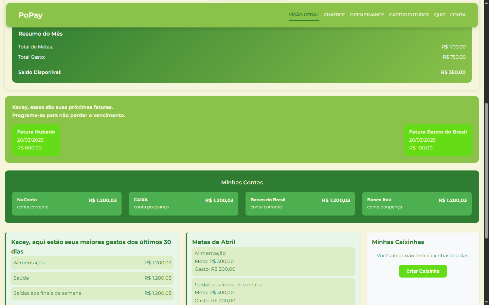

# Popay 💸

> Um sistema inteligente de gestão financeira feito para jovens que querem sair do ciclo de dívidas e conquistar estabilidade.

 

  <a href="https://popay-15c0b.web.app/"><strong>Ver Demo</strong></a>

 

### 📖 Sobre o Projeto

 Diante do aumento do endividamento entre os jovens, **Popay** surge como uma solução tecnológica para transformar a maneira como eles lidam com o dinheiro. Utilizando **Inteligência Artificial**, o sistema:

- Analisa hábitos de consumo;
- Prevê meses com maior probabilidade de gastos;
- Sugere ajustes e estratégias de economia;
- Cria **perfis financeiros personalizados**, com base no comportamento individual.

Nosso objetivo é proporcionar **autonomia financeira**, ajudando o usuário a **evitar dívidas**, **equilibrar as finanças** e garantir um futuro **mais seguro e planejado**.

#### ❗ Problema que buscamos resolver

O endividamento entre jovens tem crescido de forma alarmante, impulsionado por:

- Falta de educação financeira;
- Assumir compromissos financeiros a longo prazo, sem planejamento;
- Hábitos de consumo imediatistas e descontrolados.

### 🛠️ Tecnologias Utilizadas

- **React** – Biblioteca JavaScript para construção de interfaces de usuário dinâmicas e reutilizáveis.
- **JavaScript** – Interface interativa e responsiva  
- **HTML5 / CSS3** – Estrutura e estilo da aplicação web  
* **Deploy:** Firebase

### 📂 Instruções 

> Instruções para rodar no seu ambiente de desenvolvimento

Para executar o projeto em sua máquina local, siga os passos abaixo.

**Pré-requisitos:**
* Node.js (v18 ou superior)
* Yarn ou npm
* Git

**Instalação:**
O diretório do projeto, você pode executar:

- Instalar todas as dependências de um projeto
- Se o projeto já tem um arquivo package.json, basta rodar:
**npm install**
- Ele instalará todas as dependências listadas em package.json.

**npm run dev**
Executa o aplicativo em modo de desenvolvimento.
Abra http://localhost:3000 ou qualquer outro localhost para visualizá-lo no seu navegador.

A página será recarregada quando você fizer alterações.

### 📬 Contato

- Ana Sofia - [@Sun-cs-Sol](https://github.com/Sun-cs-Sol) - [Linkedin](https://www.linkedin.com/in/ana-sofia-moura-27b003248/)
- Camila Maria - [@camilamta275](https://github.com/camilamta275) - [Linkedin](https://www.linkedin.com/in/camilamta275/)
- Lucas Rodrigues - [@lucxsz-web](https://github.com/lucxsz-web) - [Linkedin](https://www.linkedin.com/in/lucas-rodrigues-08261b2ba/)
- René Melo- [@renysoo](https://github.com/renysoo) - [Linkedin](https://www.linkedin.com/in/renelucena/)

Link do Projeto: [[https://github.com/camilamta275/popay](https://github.com/camilamta275/popay)]
